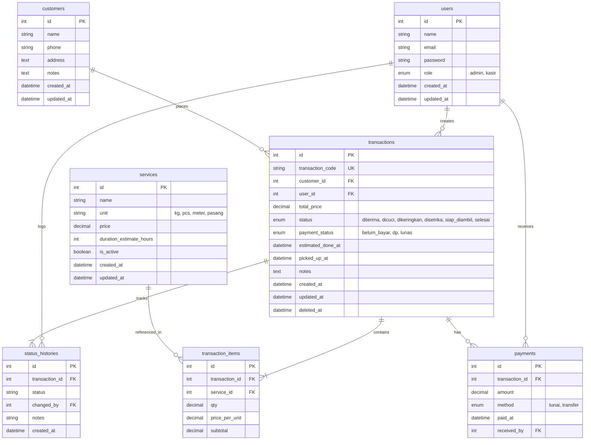

# 🧺 Sistem Informasi Manajemen Laundry (SIP-Laundry)

Sistem Informasi Manajemen Pengelolaan Laundry berbasis web yang dibangun menggunakan **CodeIgniter 4**, **MySQL**, dan **Tailwind CSS** dengan antarmuka modern terinspirasi **Horizon UI**. Aplikasi ini dirancang untuk memudahkan operasional usaha laundry, mulai dari pencatatan pesanan, pembaruan status pengerjaan bertahap, pembayaran bertahap (DP/Lunas), cetak struk termal POS 80mm, pelacakan cucian publik via WhatsApp/Kode Transaksi, hingga laporan pendapatan dan performa layanan.

---

## 📑 Daftar Isi
- [Fitur Utama](#-fitur-utama)
- [Teknologi yang Digunakan](#-teknologi-yang-digunakan)
- [Struktur Database](#-struktur-database)
- [Persyaratan Sistem](#-persyaratan-sistem)
- [Panduan Instalasi](#-panduan-instalasi)
- [Akun Pengguna Default](#-akun-pengguna-default)
- [Struktur Direktori Proyek](#-struktur-direktori-proyek)
- [Alur Kerja Sistem (Workflow)](#-alur-kerja-sistem-workflow)
- [Daftar Endpoint & Rute](#-daftar-endpoint--rute)
- [Lisensi](#-lisensi)

---

## ✨ Fitur Utama

### 1. 🔐 Autentikasi & Multi-Role
- Autentikasi sesi aman dengan middleware `AuthFilter`.
- Hak akses berbasis peran: **Admin** dan **Kasir**.
- Manajemen profil pengguna dan fitur ubah kata sandi (*Change Password*).

### 2. 📊 Dashboard Operasional Interaktif
- Ringkasan metrik harian: Transaksi Hari Ini, Omzet Hari Ini, Cucian Dalam Proses, dan Tagihan Belum Lunas.
- Tombol aksi cepat (*Quick Action*) untuk membuat transaksi baru dan menambah pelanggan.
- Tabel pemantauan pesanan terbaru beserta status pengerjaan dan pelunasan.

### 3. 🧺 Manajemen Transaksi & Kasir (POS)
- Pembuatan transaksi multi-item dengan kalkulasi subtotal dan total otomatis (didukung Alpine.js).
- Pembuatan kode transaksi unik otomatis (`TRX-YYYYMMDD-XXXX`).
- Estimasi waktu selesai otomatis berdasarkan durasi paket layanan.
- **Sistem Pelacakan Status 6 Tahap**:
  `Diterima` ➔ `Dicuci` ➔ `Dikeringkan` ➔ `Disetrika` ➔ `Siap Diambil` ➔ `Selesai`.
- Pencatatan riwayat transisi status (*Status History Logs*) mencakup waktu dan staf penanggung jawab.
- **Pencatatan Pembayaran Fleksibel**: Mendukung pembayaran Lunas, Uang Muka (DP), dan Belum Bayar (Metode Tunai / Transfer).
- **Aturan Bisnis Ketat**: Cucian tidak dapat diserahkan/diselesaikan (`Selesai`) jika sisa tagihan belum dilunasi.
- **Cetak Nota/Struk Termal**: Diformat khusus untuk printer termal POS ukuran 80mm/58mm dengan tombol cetak langsung (`window.print()`).
- Filter data komprehensif (berdasarkan status pengerjaan, status pembayaran, pelanggan, rentang tanggal, dan kata kunci pencarian) disertai navigasi halaman (Pagination).

### 4. 🔍 Pelacakan Status Cucian Publik (Tanpa Login)
- Halaman publik di `/track` yang dapat diakses oleh pelanggan tanpa perlu login.
- Pelanggan cukup memasukkan **Kode Transaksi** atau **Nomor WhatsApp/HP**.
- Tampilan garis waktu (*Timeline Progress Bar*) interaktif yang memperlihatkan posisi tahapan cucian secara *real-time*.

### 5. 👥 Manajemen Pelanggan (CRM)
- Pencatatan data pelanggan (Nama, Nomor WhatsApp/Telepon, Alamat, Catatan).
- Pencarian cepat pelanggan dan histori transaksi.

### 6. 🏷️ Manajemen Layanan & Tarif
- Katalog layanan fleksibel (Kiloan, Satuan, Dry Clean, Cuci Karpet/Sepatu/Bedcover, dsb.).
- Satuan kustom (`kg`, `pcs`, `meter`, `pasang`).
- Pengaturan tarif harga dan estimasi durasi pengerjaan dalam jam.
- Pengaturan status aktif/nonaktif layanan.

### 7. 📈 Laporan & Analitik Keuangan
- **Laporan Pendapatan (Revenue)**: Total omzet, jumlah pembayaran, dan rincian transaksi berdasarkan filter rentang tanggal.
- **Laporan Performa Layanan**: Statistik volume pengerjaan dan kontribusi omzet per jenis paket layanan laundry.
- Dukungan cetak laporan ramah printer (*Print-ready layout*).

### 8. 🎨 Desain Modern & Mode Gelap
- Antarmuka berbasis Horizon UI yang bersih, responsif, dan elegan.
- Dukungan penuh **Light Mode** & **Dark Mode** dengan transisi halus.

---

## 🛠️ Teknologi yang Digunakan

- **Backend Framework**: [CodeIgniter 4](https://codeigniter.com/) (PHP 8.2+)
- **Database**: MySQL / MariaDB (InnoDB Engine)
- **Frontend UI & Styling**: [Tailwind CSS](https://tailwindcss.com/)
- **Interaktivitas Client**: [Alpine.js](https://alpinejs.dev/)
- **Ikonografi**: [Lucide Icons](https://lucide.dev/)
- **Tipografi**: Google Fonts (*Plus Jakarta Sans*, *DM Sans*, & *Courier Prime*)

---

## 🗄️ Struktur Database

Database `db_laundry` terdiri dari 7 tabel utama dengan integritas relasional:



---

## 💻 Persyaratan Sistem

Pastikan lingkungan server lokal Anda memenuhi spesifikasi berikut:
- **PHP**: Versi **8.2** atau lebih tinggi
- **Ekstensi PHP Aktif**: `intl`, `mbstring`, `json`, `mysqlnd`, `curl`
- **Database Server**: MySQL 5.7+ / MariaDB 10.3+
- **Composer**: Versi 2.0+

---

## 🚀 Panduan Instalasi

Ikuti langkah-langkah berikut untuk menjalankan proyek di komputer lokal:

### 1. Clone Repositori
```bash
git clone <URL_REPOSITORY_ANDA>
cd Laundry
```

### 2. Instal Dependensi Composer
```bash
composer install
```

### 3. Konfigurasi Environment (`.env`)
Salin berkas `env` menjadi `.env` jika belum ada:
```bash
cp env .env
```
Buka berkas `.env` dan sesuaikan konfigurasi database dan baseURL:
```ini
CI_ENVIRONMENT = development

app.baseURL = 'http://localhost:8080/'

database.default.hostname = localhost
database.default.database = db_laundry
database.default.username = root
database.default.password = 
database.default.DBDriver = MySQLi
database.default.port = 3306
```

### 4. Buat Database MySQL
Buat database baru bernama `db_laundry` pada phpMyAdmin atau terminal MySQL:
```sql
CREATE DATABASE db_laundry CHARACTER SET utf8mb4 COLLATE utf8mb4_unicode_ci;
```

### 5. Jalankan Migrasi & Database Seeder
Jalankan perintah Spark untuk membuat seluruh tabel dan mengisi data awal (pengguna, layanan standar, dan data pelanggan sampel):
```bash
php spark migrate
php spark db:seed DatabaseSeeder
```

### 6. Jalankan Server Pengembangan
```bash
php spark serve
```
Akses aplikasi melalui browser di: `http://localhost:8080`

---

## 🔑 Akun Pengguna Default

Setelah menjalankan `DatabaseSeeder`, Anda dapat login menggunakan kredensial default berikut:

| Role | Email | Password | Hak Akses |
| :--- | :--- | :--- | :--- |
| **Admin** | `admin@laundry.com` | `admin123` | Akses penuh (Transaksi, Master Layanan, Master Pelanggan, Laporan Keuangan, Profil) |
| **Kasir** | `kasir@laundry.com` | `kasir123` | Operasional Kasir (Transaksi, Pelanggan, Cetak Struk, Pembayaran) |

---

## 📁 Struktur Direktori Proyek

```
Laundry/
├── app/
│   ├── Config/              # Konfigurasi aplikasi, database, rute, filter
│   ├── Controllers/         # Auth, Dashboard, Customer, Service, Transaction, Track, Report
│   ├── Database/
│   │   ├── Migrations/      # Berkas migrasi skema tabel
│   │   └── Seeds/           # Data awal (UserSeeder, ServiceSeeder, CustomerSeeder)
│   ├── Filters/             # AuthFilter (Session Authentication Middleware)
│   ├── Models/              # UserModel, CustomerModel, ServiceModel, TransactionModel, dsb.
│   └── Views/               # Template tampilan Blade/PHP
│       ├── auth/            # Halaman Login & Profil Akun
│       ├── customers/       # Index, Form Tambah, & Form Edit Pelanggan
│       ├── dashboard/       # Dashboard Statistik Utama
│       ├── layouts/         # Layout Induk (main.php & public.php)
│       ├── pagers/          # Custom Pagination View
│       ├── reports/         # Laporan Pendapatan & Performa Layanan
│       ├── services/        # Index & Form Layanan/Tarif
│       ├── track/           # Halaman Publik Pelacakan Status Cucian
│       └── transactions/    # Index, Form Transaksi Baru, Detail/Timeline, & Cetak Nota
├── public/                  # Document root publik (index.php, logo, aset gambar)
├── writable/                # File cache, logs, dan sesi aplikasi
├── .env                     # Konfigurasi environment lokal
├── composer.json            # Daftar dependensi PHP
├── README.md                # Dokumentasi proyek
└── spark                    # CLI Command Tool CodeIgniter 4
```

---

## 🔄 Alur Kerja Sistem (Workflow)

1. **Penerimaan Pesanan (`Diterima`)**:
   - Kasir memilih pelanggan terdaftar atau menambahkan pelanggan baru.
   - Memilih paket layanan yang dipesan (kiloan/satuan) beserta jumlahnya.
   - Kasir mencatat opsi pembayaran awal (Belum Bayar / DP / Lunas).
   - Sistem mencetak nota/struk kasir untuk diberikan kepada pelanggan.
2. **Proses Pengerjaan Laundry**:
   - Operator mencuci pesanan ➔ status diubah ke `Dicuci`.
   - Pesanan dikeringkan ➔ status diubah ke `Dikeringkan`.
   - Pesanan disetrika dan dipacking ➔ status diubah ke `Disetrika`.
   - Cucian siap diambil ➔ status diubah ke `Siap Diambil`.
3. **Pelacakan oleh Pelanggan**:
   - Pelanggan dapat membuka menu **Lacak Cucian** (`/track`) dan memasukkan nomor nota untuk memantau status secara langsung.
4. **Pengambilan & Pelunasan (`Selesai`)**:
   - Pelanggan datang mengambil cucian membawa nota.
   - Jika masih ada sisa tagihan (*balance due*), kasir mencatat pelunasan pembayaran melalui tombol **Catat Pembayaran**.
   - Setelah tagihan lunas, status pesanan dapat diperbarui menjadi `Selesai`.

---

## 🛣️ Daftar Endpoint & Rute

| Metode | URL / Path | Controller & Fungsi | Keterangan | Akses |
| :--- | :--- | :--- | :--- | :--- |
| `GET` | `/` | Redirect Handler | Arahkan ke `/dashboard` atau `/login` | Publik |
| `GET` / `POST` | `/login` | `Auth::login` / `attemptLogin` | Halaman form & proses login | Publik |
| `GET` | `/logout` | `Auth::logout` | Menghapus sesi login | Authenticated |
| `GET` / `POST` | `/track` | `TrackController::index` / `check` | Halaman pelacakan status cucian | Publik |
| `GET` | `/dashboard` | `Dashboard::index` | Ringkasan metrik & data operasional | Authenticated |
| `GET` | `/profile` | `Auth::profile` | Halaman profil user & ganti password | Authenticated |
| `POST` | `/profile/change-password` | `Auth::changePassword` | Proses ganti kata sandi | Authenticated |
| `GET` | `/customers` | `CustomerController::index` | Daftar pelanggan & pencarian | Authenticated |
| `POST` | `/customers/store` | `CustomerController::store` | Tambah pelanggan baru | Authenticated |
| `POST` | `/customers/update/(:num)`| `CustomerController::update` | Edit data pelanggan | Authenticated |
| `GET` | `/customers/delete/(:num)`| `CustomerController::delete` | Hapus data pelanggan | Authenticated |
| `GET` | `/services` | `ServiceController::index` | Katalog layanan & tarif | Authenticated |
| `POST` | `/services/store` | `ServiceController::store` | Tambah layanan baru | Authenticated |
| `POST` | `/services/update/(:num)` | `ServiceController::update` | Edit tarif/layanan | Authenticated |
| `GET` | `/services/delete/(:num)` | `ServiceController::delete` | Nonaktifkan/hapus layanan | Authenticated |
| `GET` | `/transactions` | `TransactionController::index` | Daftar seluruh transaksi & filter | Authenticated |
| `GET` | `/transactions/create` | `TransactionController::create`| Form kasir transaksi baru | Authenticated |
| `POST` | `/transactions/store` | `TransactionController::store` | Simpan transaksi baru | Authenticated |
| `GET` | `/transactions/detail/(:num)`| `TransactionController::detail`| Detail pesanan, timeline & bayar | Authenticated |
| `POST` | `/transactions/updateStatus/(:num)` | `TransactionController::updateStatus` | Perbarui status proses cucian | Authenticated |
| `POST` | `/transactions/pay/(:num)` | `TransactionController::pay` | Catat pembayaran tagihan | Authenticated |
| `GET` | `/transactions/print/(:num)` | `TransactionController::print` | Tampilan cetak nota termal 80mm | Authenticated |
| `GET` | `/transactions/delete/(:num)`| `TransactionController::delete` | Hapus transaksi (Soft Delete) | Authenticated |
| `GET` | `/reports/revenue` | `ReportController::revenue` | Laporan omzet & pendapatan | Authenticated |
| `GET` | `/reports/services` | `ReportController::byService` | Laporan performa paket layanan | Authenticated |

---

## 📄 Lisensi

Proyek ini dikembangkan untuk kebutuhan operasional manajemen laundry dan menggunakan lisensi [MIT License](LICENSE).
